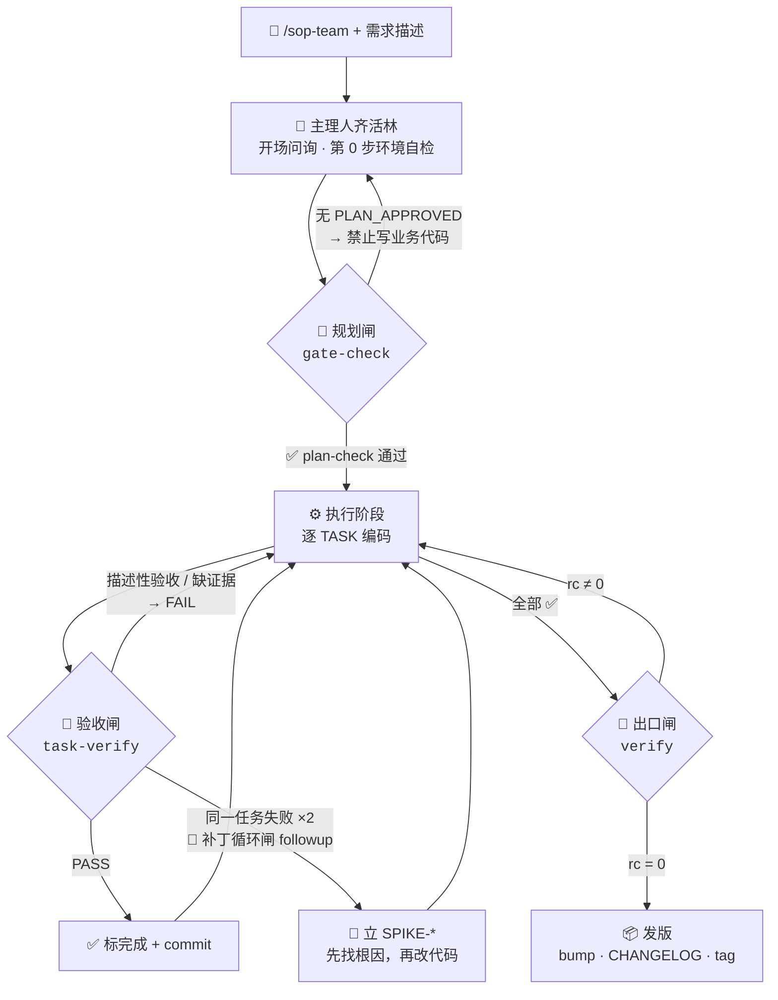

<div align="center">


# 代码工程 SOP 专家团

**把"聊完就散"的开发协作，变成先规划、可验收、能连跑的团队级工程流程。**

13 位角色（4 常驻 + 9 按需）由主理人按需调度，9 个能力技能覆盖需求、架构、规划、测试、安全与发版，
四道硬闸门由一个零依赖 Python CLI 执行——**退出码是唯一判据**。

[](https://github.com/wangqiqi/code-sop-team-zcode/releases/tag/v2.5.0)
[](#-安装)
[](#-状态与运行要求)
[](code-sop-team/tests/test_sop_gate.py)
[](#-团队阵容)
[](#-技能清单)

**安装**：ZCode → 插件市场 → 添加插件市场 → 粘贴本仓库 URL

</div>

---

> **免责声明**：本插件是工程流程工具，不替代专业判断。架构取舍、安全结论与发版决定仍需由负责人复核后使用。

## 🎯 它解决什么问题

| 没有 SOP 专家团 | 有了 SOP 专家团 |
|---|---|
| 聊完就散，方案落不了地 | 目标、验收标准、Out of scope 先冻结成 `plan.md` |
| "看着差不多"就标完成 | 每个任务一条**可执行验收命令**，PASS 才能打 ✅ |
| 补丁打了一轮又一轮 | 同一任务失败 2 次 → 强制停下立 `SPIKE-*` 找根因 |
| 发版靠记忆和运气 | 出口闸要求全部任务 ✅ + verify 绿灯，才允许打 tag |

**适用角色**：技术/交付负责人（把住开工与收口）、前后端工程师（验收命令化）、测试/安全/数据工程师（按需只读走查，结论落 `file:line`）、独立开发者与小团队（一个人借用完整团队节奏）。

## 👥 团队阵容

### 常驻核心（每场必到）

<div align="center">

| <br>**齐活林** | <br>**许清楚** | <br>**严过关** | <br>**毕达成** |
|:---:|:---:|:---:|:---:|
| 交付总监（主理人） | Sprint 规划师 | 代码审查官 | 发版工程师 |
| 路由编排<br>守四道闸门 | 冻结目标<br>MECE 拆任务 | 只读双轴审查<br>Blocker/High 分级 | 自治打版<br>verify 绿灯才发 |

</div>

### 按需专家（需求信号触发，平时不打扰）

<div align="center">

| <br>**文知需** | <br>**梁定边** | <br>**查必现** | <br>**卫无漏** | <br>**颜可悦** |
|:---:|:---:|:---:|:---:|:---:|
| 产品经理 | 架构师 | 测试工程师 | 安全工程师 | UI/UX 设计师 |
| 需求澄清<br>验收标准可执行化 | 边界划分<br>依赖方向 · ADR | 用例矩阵<br>缺陷复现 | 威胁建模<br>鉴权 · 密钥治理 | 信息架构<br>六态设计 |

| <br>**石不移** | <br>**高见远** | <br>**舒井然** | <br>**古小励** |
|:---:|:---:|:---:|:---:|
| 数据工程师 | 技术调研员 | 工程事务官 | 程序员鼓励师 |
| schema 迁移<br>索引 · 备份回滚 | 方案对比<br>根因定位 | 环境核对<br>文档备料 | 仅情绪节点<br>1~3 句打气 |

</div>

> 12 位团员各自是插件子智能体（`agents/*.md`）：身份、方法、纪律、输出规范内置于定义，只读专家不给补丁代码、只给方向；Blocker 永远是 Blocker，不因语气降级。

## 🔄 工作流程与四道硬闸门



**闸门细则**：

1. **规划闸** `gate-check` — 没有 `PLAN_APPROVED`（真实日期）或仍在规划期 → 禁止写业务代码。`approve` 会先校验 `VERIFY` 已设、`plan-check` 通过。
2. **验收闸** `task-verify` — 每个任务的验收命令必须 PASS 才能标 ✅ / commit；描述性验收直接 FAIL；`manual:` 验收必须带 `--evidence` 留证（否则 rc=3）。验收要求一改，旧证据立即失效。
3. **出口闸** `verify` — Sprint 收尾/打版前要求**任务全部 ✅ + `VERIFY` 命令退出码 0**。plan 解析不到任务直接 FAIL；残项需 `--force` 且你明确接受。
4. **补丁循环闸** `followup` — 同一任务连续失败 **2 次**即输出 `FOLLOWUP-GATE`，禁止继续打补丁，必须立 `SPIKE-*` 定位根因。

**退出码语义**：`0` 通过 · `1` BLOCK/FAIL · `2` 参数/环境错 · `3` 等待人工证据。任何非 0 都不得继续编码、标完成或提交。闸门 CLI fail-closed、原子锁、超时杀进程树——**闸门结果不伪造，缺环境时显式降级并声明**。

## 📦 安装

**环境要求**：ZCode 桌面客户端；Python 3.8+（闸门脚本用，纯标准库，没有则硬闸显式降级为软约束）；可选 git（发版与 pre-commit 钩子用）。

### 方式 1 · 插件市场安装（推荐，可启停可更新）

ZCode → **插件市场 → 添加 → 添加插件市场** → 粘贴：

```
https://github.com/wangqiqi/code-sop-team-zcode
```

然后 **个人 → 找到「代码工程 SOP 专家团」→ 安装**。管理入口在 **设置 → 插件**；有新版本时点「刷新该市场 → 更新」。

### 方式 2 · 用户级直装（零 UI）

```bash
git clone https://github.com/wangqiqi/code-sop-team-zcode.git
cd code-sop-team
mkdir -p ~/.zcode/skills ~/.zcode/agents ~/.zcode/bin ~/.zcode/tests

cp -r code-sop-team/skills/*               ~/.zcode/skills/
cp    code-sop-team/agents/*.md            ~/.zcode/agents/
cp    code-sop-team/bin/sop_gate.py        ~/.zcode/bin/
cp    code-sop-team/tests/test_sop_gate.py ~/.zcode/tests/
```

Windows（PowerShell）：

```powershell
git clone https://github.com/wangqiqi/code-sop-team-zcode.git
cd code-sop-team
New-Item -Force -ItemType Directory ~/.zcode/skills, ~/.zcode/agents, ~/.zcode/bin, ~/.zcode/tests | Out-Null

Copy-Item -Recurse -Force code-sop-team\skills\*               ~/.zcode\skills\
Copy-Item           code-sop-team\agents\*.md                  ~/.zcode\agents\
Copy-Item           code-sop-team\bin\sop_gate.py              ~/.zcode\bin\
Copy-Item           code-sop-team\tests\test_sop_gate.py       ~/.zcode\tests\
```

重开一个新会话即生效。

### 验证安装

开个新任务，任意说一句：

- 「帮我规划一个加 `--verbose` 参数的小功能」→ 应看到逐卡问询 → 环境自检 → 规划师产出任务表
- 「用 code-reviewer review 一下」→ 应看到只读审查、按 Blocker/High 分级输出

### 卸载

```bash
rm -rf ~/.zcode/skills/{sop-team,sop-gate,product-spec,architecture-design,ux-design,stack-conventions,quality-checklists,delivery-contracts,release-ops}
rm -f  ~/.zcode/agents/{sprint-planner,code-reviewer,release-engineer,product-manager,architect,qa-engineer,security-engineer,ux-designer,data-engineer,tech-spiker,morale-booster,engineering-steward}.md
rm -f  ~/.zcode/bin/sop_gate.py ~/.zcode/tests/test_sop_gate.py
```

## 🚀 快速指令

| 指令 | 用途 |
|------|------|
| `/sop-team` + 需求描述 | 主理人接管：开场问询 → 规划 → 你确认 → 执行 → 收口发版 |
| `/sop-team` + "review 一下" | 只走代码审查，按 Blocker/High 分级给结论 |
| `/sop-gate` | 手动跑闸门，如 `task-verify TASK-002`、`verify`、`doctor` |
| `/product-spec` | 需求说不清时先把目标、验收标准与 Out of scope 冻结 |
| `/architecture-design` | 分层、边界、依赖方向、要不要重构 |
| `/ux-design` | 页面结构、交互流程、六态、视觉 token |
| `/quality-checklists` | 安全 / API / 测试 / 性能 / 补丁循环专项检查 |
| `/delivery-contracts` | 交付七维验收、测试报告、使用说明书 |
| `/release-ops` | Git 纪律、发版四选一、semver、脚手架 |

## 🛠️ 技能清单

| 技能 | 作用与内置方法 |
|------|----------------|
| `sop-team` | 主理人编排：**第 0 步环境自检**、5 张开场卡（人格/项目/需求/阵容/目录）、路由表、Phase 0–5、Workflow 0/A–J、12 份角色手册按需派单、异常兜底矩阵 |
| `sop-gate` | 四道硬闸执行器：`init` `gate-check` `plan-check` `task-verify` `verify` `next-task` `followup` `approve` `set` `doctor` + 可选 git pre-commit |
| `product-spec` | 需求澄清四问、用户故事、**验收标准可执行化**、MoSCoW、范围谈判 |
| `architecture-design` | 边界划分、依赖方向、ADR、技术债记账、数据层（schema/迁移/索引/备份/一致性） |
| `ux-design` | 信息架构、交互流程、**六态设计**、视觉 token、可用性走查 |
| `stack-conventions` | TS/JS/ESLint、React/Vue/Svelte/Next、Python/Go/Java、Rust/C/C++ 的编码约定与各栈完成判据 |
| `quality-checklists` | 安全清单、API 契约、测试分层、调试循环、**补丁循环拦截**、性能手册、重构协议 |
| `delivery-contracts` | 交付七维验收、测试报告契约、使用说明书契约 |
| `release-ops` | Git 纪律、发版四选一 + semver、部署、脚手架、长程三层规划 |

## ⚙️ 第 0 步环境自检

开工前先自检，避免在缺解释器 / 缺脚本的机器上白跑一轮：

1. **开场即查**：跑 `skills/sop-team/scripts/preflight.ps1`（或 `preflight.sh`）。脚本从自身位置上三级推导插件根、就地定位 `bin/sop_gate.py`，并按 **PATH → 常见安装位置** 的顺序找一个能用的 3.8+ 解释器。用 `-V` 验真，跳过 Windows 的 Store 占位 `python3.exe`。
2. **目录确定后**：同一脚本加 `-Root <代码目录>`（bash 用 `--root`），内部跑 `doctor` 并只摘 FAIL / WARN。有 FAIL 阻塞开工；只有 WARN（非 git 仓库、plan 未初始化）可开工但要说明影响。
3. **结论入汇报**：解释器 · 脚本 · 钩子 · 是否降级。

四条路都找不到解释器时不会静默降级：会明确告知「软约束降级模式」，流程与角色手册照常，但硬拦截不生效，且不得声称全流程闭环。

## 📋 状态与运行要求

- 状态目录：`<项目根>/.zcode/sop/`（`plan.md`、`evidence.json`、`followup.json`），`init` 会自动写进 `.gitignore`。
- 项目根探测：`--root` > `SOP_PROJECT_ROOT` > 向上找 `.git` > 当前目录。
- 运行时：任意 Python 3.8+（纯标准库）。会话里按 `python` → `py -3` → `python3` 探测。
- 回归自测：`python tests/test_sop_gate.py`（43 个用例，零依赖）。改过闸门脚本后必须全绿。

## 💬 常见用法

- 我要开发一个功能，先冻结目标、拆任务，等我确认再执行。
- 帮我审查当前改动能不能合并，按严重度列出 Blocker 和 High。
- 这两个技术方案帮我对比一下，给出明确推荐和任务拆分建议。
- 这 bug 我已经修了三次还没好，帮我判断该不该换个思路。
- 这个接口谁都能传 userId，帮我看看安全上有没有洞。
- 我要加个字段还要写迁移，怎么保证能回滚？
- 按清单发个版，先跑 verify，绿了再打 tag。

## 🔌 连接器（可选增强）

| 你想做的事 | 不连接器也能做 | 连上后更顺 |
|-----------|---------------|-----------|
| 代码审查 | 贴 diff 或本地读文件 | 直接读 PR diff 并把结论发回 PR |
| 任务规划 | TASK 落在 `plan.md` | 同步成 Jira / Linear issue 并回写状态 |
| 交付归档 | 本地文件 | 发布成钉钉文档 / Notion 页面 |

> 所有技能在没有连接器时均可正常使用。配置方式见 [CONNECTORS.md](code-sop-team/CONNECTORS.md)。

## 📝 版本与移植说明

本插件自 QwenWork 版 `code-sop-team` 2.3.0 移植，主要改动：

- **12 位团员由「角色手册」升级为真正的插件子智能体**（`agents/*.md`，身份、方法、纪律、输出规范内置于各自定义）：主技能用 ZCode 的 Agent 工具按 `subagent_type` 派单；Agent 工具不可用时进入单会话代行模式并**显式标注**，不冒充独立成员结论。
- **开场问询改用 `AskUserQuestion`** 逐张发卡；工具不可用时降级为正文逐项询问。
- **状态目录**由 `.qwenwork/sop/` 改为 `.zcode/sop/`（与 ZCode 工作区约定一致），CLI 常量、git 钩子与 43 个回归用例同步更新。
- **脚本定位改为插件根相对定位**（技能基目录上两级）+ `SOP_GATE` 环境变量兜底；Python 探测只保留 PATH 与常见安装位置，不再探测特定客户端的受管解释器。
- **连接器统一走 MCP**（Settings → MCP 或 `mcp.servers` 配置），见 `CONNECTORS.md`。
- 清单换成 `.zcode-plugin/plugin.json`（含 `skills` + `agents` 声明）；**第 0 步环境自检**保留，缺 Python 时显式声明软约束降级，不静默放行。

## 🙏 致谢

- **QwenWork `code-sop-team` 2.3.0** — 本插件的原始版本，角色设定与四道闸门方法论源自该项目
- **ZCode** — 插件体系（子智能体 / 技能 / 插件市场）承载平台

---

<div align="center">

**13 人是菜单，不是仪仗队。** 默认只上常驻 4 人，需要时再请专家。
试试对你的 ZCode 说：*「帮我规划一个功能」*

</div>
